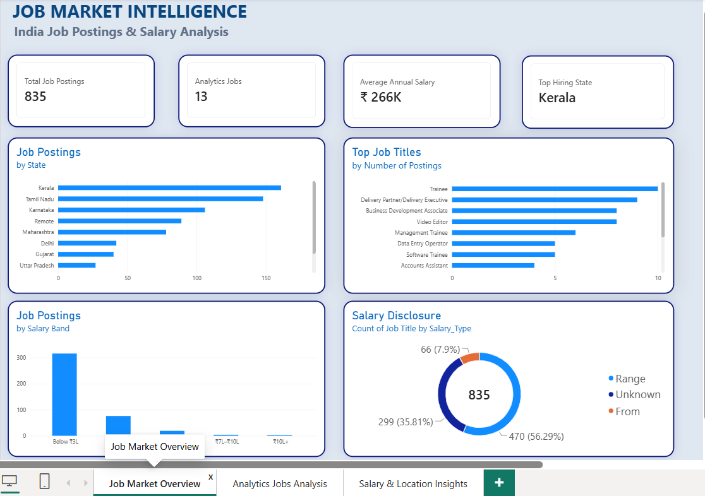

# Job Market Intelligence

### An End-to-End Data Analytics Project Using Python, SQL & Power BI

## 📌 Project Overview

This project analyzes **835 Indian job postings** to explore job-market trends, geographic distribution, salary patterns, and salary disclosure.

The project demonstrates an end-to-end data analytics workflow, from raw data cleaning and salary standardization to SQL analysis and interactive Power BI dashboard development.

## 🎯 Project Objectives

- Analyze job postings across states and locations.
- Identify the most frequently appearing job titles.
- Clean and standardize salary information.
- Convert monthly salary figures into annual salary metrics where applicable.
- Examine salary ranges and salary disclosure patterns.
- Identify analytics-related postings using job-title keyword matching.
- Present findings through an interactive Power BI dashboard.

## 🛠️ Tools & Technologies

| Tool | Application |
|---|---|
| Python | Data cleaning and preprocessing |
| Pandas | Data manipulation |
| NumPy | Numerical operations |
| Regex | Salary extraction |
| MySQL | Data querying and analysis |
| Power BI | Interactive dashboard development |
| DAX | Measures and calculated columns |

## 🔄 Project Workflow

1. **Data Preparation:** Loaded the raw CSV dataset using Python.
2. **Data Cleaning:** Standardized text fields and processed salary information.
3. **Salary Transformation:** Extracted salary values and converted monthly figures into annual equivalents where applicable.
4. **SQL Analysis:** Queried job postings to explore job titles, locations, and salary disclosure.
5. **Job Classification:** Identified analytics-related roles using keywords in job titles.
6. **Visualization:** Built a three-page Power BI dashboard to communicate findings.

## 📂 Repository Structure

```text
Job-Market-Intelligence/
├── Data/
│   ├── job_market.Raw.csv
│   ├── job_market_cleaned.csv
│   └── analytics_jobs.csv
├── Python/
│   └── 01_salary_cleaning.ipynb
├── SQL/
│   ├── 01_job_market_analysis.sql
│   └── job_market_insert.sql
├── Power BI/
│   └── Dashboard.pbix
├── Screenshots/
│   ├── Overview.png
│   ├── Analytics Analysis.png
│   └── salary& Locationanalysis.png
└── README.md
```

## 📊 Power BI Dashboard

The interactive dashboard contains three analytical pages.

### 1. Job Market Overview

Explores overall job-posting distribution, frequently appearing job titles, salary bands, and salary disclosure.



### 2. Analytics Job Market

Examines analytics-related postings, their geographic distribution, job-title patterns, and available salary information.


### 3. Salary & Location Insights

Explores salary ranges, job locations, salary comparisons, and salary disclosure categories.


## 🔍 Key Findings

- **835 job postings** were included in the analysis.
- **Kerala** had the highest number of postings in this dataset.
- **13 postings** matched the selected analytics-related job-title keywords.
- Salary information included salary ranges, minimum salary offers described as "From", and postings without usable salary information.
- Geographic and salary patterns were explored using SQL and Power BI.

## ⚠️ Data & Methodology Notes

- The findings describe the dataset analyzed and should not be treated as a complete representation of the Indian job market.
- Analytics-related postings were identified through job-title keyword matching. This method may miss relevant roles or include roles with different responsibilities.
- Salary averages were calculated only where usable salary information was available.
- Monthly and annual salary figures were standardized where the source provided a recognizable pay period.
- Salary figures and job-posting counts depend on the source data and its completeness.

## 🚀 Skills Demonstrated

- Data cleaning and preprocessing
- Exploratory data analysis
- Python programming
- SQL querying and aggregation
- Salary data transformation
- Power BI dashboard development
- DAX calculations
- Data visualization and insight communication

## 🔮 Future Improvements

- Expand the dataset with more job postings.
- Analyze required skills such as Python, SQL, and Power BI when skill-level data becomes available.
- Add company, industry, and experience-level analysis when those fields are available.
- Track job-market changes over time.

## 👩‍💻 Author

**Chandana S Krishna**  
B.Tech in Computer Science and Engineering  
Aspiring Data Analyst

**Tools:** Python | SQL | MySQL | Power BI | DAX
